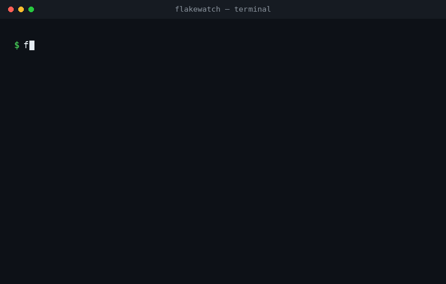

# flakeguard

### Your test suite is lying to you.



Flakeguard finds the tests that **randomly pass and fail**, ranks them by how
unreliable they are, and shows you why — so you can trust your tests again.

**Free · private · works with any language.** No account, no sign-up, and
nothing leaves your machine.

[](https://github.com/PrathameshKulkarni2k4/flakeguard/actions/workflows/ci.yml)
[](LICENSE)
[](https://www.python.org/)

---

## The problem, in 30 seconds

You have a test that fails once in a while. You re-run it. It passes. Was
that a real bug? A flaky test? Nobody knows — so everyone ignores it, and
that is exactly how real bugs hide.

A flaky test costs a team hours, and slowly destroys trust in the entire
test suite. Flakeguard fixes the hard half of the problem: it tells you
**exactly which tests are unreliable**, and how unreliable.

## Try it in 60 seconds

```bash
pipx install flakeguard
flakeguard scan ./reports        # a folder of test reports
```

No reports yet? Run it against the examples bundled in this repo:

```bash
git clone https://github.com/PrathameshKulkarni2k4/flakeguard
cd flakeguard
flakeguard scan examples/reports
```

## What it does

- Reads your test results from **many runs** (the more runs, the sharper the
  picture).
- Finds the tests that **disagree with themselves** across those runs.
- Gives each one a score from **0 (solid) to 1 (a coin-flip)**.
- Shows the **latest failure message**, so you can go fix it.
- Runs in your **CI** and can leave a comment on the pull request — or block
  it when flakiness spikes.

## Works with any language

Flakeguard reads **JUnit XML**, the report format almost every test
framework can produce. One tool, every language:

| Language / framework | How to produce the report |
|---|---|
| Python (pytest) | `pytest --junitxml=report.xml` |
| Java (Maven / Gradle) | Surefire writes JUnit XML automatically |
| Go | `gotestsum --junitfile report.xml` |
| JavaScript (Jest) | the `jest-junit` reporter |
| Ruby (RSpec) | the `rspec_junit_formatter` gem |
| .NET, PHPUnit, … | built-in or plugin JUnit output |

Flakeguard also reads **TAP** (the Test Anything Protocol — Node's built-in
test runner, the `tap`/`tape` libraries, Perl's Test::More) and **Jest-style
JSON** reports (`jest --json > report.json`).

Maven and Gradle Surefire write **one XML per test class**, so pass
`--single-run` to treat a whole directory as a single run.

## Use in CI (GitHub Actions)

```yaml
- name: Flakeguard
  uses: PrathameshKulkarni2k4/flakeguard@main
  with:
    reports: reports      # dir/glob of JUnit XML files
    min-runs: 3           # ignore tests seen in fewer runs
    max-flaky: 0          # fail if any flaky test is found (-1 = never fail)
    comment: "true"       # post the report as a PR comment
```

See [`.github/workflows/example.yml`](.github/workflows/example.yml) for a
complete workflow that runs a suite several times and feeds the reports in.

To gate locally or in any other CI, use the exit code:

```bash
flakeguard scan ./reports --fail-on-flaky   # exits 1 if anything is flaky
```

## How the score works

**A test can only be flaky on the same code.** That is the whole idea. If a
test passed for twenty builds and then failed for twenty more, a regression
landed — it is not flaky, and calling it flaky is how real bugs get ignored.
So flakeguard counts disagreement *within* a commit:

```
score = 2 * Σ(per-commit flips) / Σ(per-commit decided runs)
```

- always passes, or always fails → **0.0** (consistent, *not* flaky)
- flips on every run of the same commit → **1.0** (maximally flaky)

Only commits that **ran the test more than once** count. A commit where the
test ran once can never show a flip, so including it would only dilute the
score — and one run per commit is the most common CI shape of all. If a test
changed across commits but no single commit ran it twice, flakeguard reports
it as **unconfirmed** rather than guessing:

```
3 test(s) behaved differently across commits, but no commit ran them
more than once - so flakeguard cannot tell a flake from a regression:
    tests.checkout::test_coupon
  -> run the suite more than once per commit (or enable retries) to confirm.
```

**Retries are decisive.** If your runner retries a failing test and records
it (Surefire's `<flakyFailure>`, and similar), flakeguard treats that as
evidence on its own — a test that failed and then passed on retry is flaky
whatever the history says.

Give flakeguard a commit so it can tell a flake from a regression:

```bash
flakeguard scan ./reports --commit "$GITHUB_SHA"
```

It also picks one up automatically from `GITHUB_SHA`, `CI_COMMIT_SHA`,
`GIT_COMMIT` and `CIRCLE_SHA1`, so most CI setups get this for free.

**Without commit information** flakeguard falls back to pooling every run.
That still finds real flakes, but it *cannot* distinguish a flake from a
regression — so it says so, in the report and on stderr, rather than
pretending to be sure.

It is deliberately explainable — no black box. You can read the number and
know exactly how it was derived.

## Quarantine known flakes

Once you've looked at a flaky test and decided "yes, we know about this one,"
you don't want it failing CI forever — but you don't want to forget it either.
Quarantine sets known flakes aside so **new** ones stand out.

```bash
# accept today's flakes as known
flakeguard scan ./reports --update-quarantine

# from now on: CI fails only on NEW flakes
flakeguard scan ./reports --quarantine flakeguard-quarantine.txt --fail-on-flaky
```

The quarantine file is plain text — one glob pattern per line, so you can set
aside a whole file of tests at once:

```
tests/checkout::test_applies_coupon
tests/search::test_ranking_*
```

## Learn across builds (history)

Flakiness needs several runs to see. Rather than collecting report files by
hand, give flakeguard a history file and run it once per build — it appends
each run and analyses everything it has seen, so the picture sharpens on its
own.

```bash
# once per build (locally or in CI):
flakeguard scan ./reports --history .flakeguard/history.db

# see what's stored:
flakeguard history .flakeguard/history.db

# start over:
flakeguard history .flakeguard/history.db --clear
```

Keep the file in your CI cache (or commit it) so it survives between builds.
It keeps the most recent 30 runs by default — change that with
`--history-keep N`.

Each run also records the **commit** it came from (from `--commit`, or your
CI's environment). That matters as history grows: without it, a regression
that landed months ago would look like a flake.

## Failure clusters

When a suite has hundreds of flaky tests, they are usually a handful of root
causes wearing different names — one flaky database, one slow network, one
shared fixture. Flakeguard groups flakes whose failure messages look the
same, so "200 flaky tests" reads as "2 causes":

```
failure clusters (2) - similar flakes, likely one cause:
  4x  ConnectionRefusedError: Connection refused to <n>.<n>.<n>.<n>:<n>
        tests.orders::test_create_order
        tests.orders::test_update_order
        ... and 2 more
  2x  TimeoutError: request timed out after <n>s
        tests.auth::test_login_flow
        tests.auth::test_signup_flow
```

## Roadmap

- [x] JUnit XML parsing, flakiness scoring, text/JSON/Markdown reports
- [x] GitHub Action with PR comments and a flakiness budget
- [x] TAP report format
- [x] Jest-style JSON report format
- [x] Quarantine file so known flakes are set aside, not deleted
- [x] CI history so it learns across builds
- [x] Failure-signature clustering (group the *same* flake across tests)
- [x] Commit-aware scoring (a regression is not a flake)
- [x] Retry awareness (a test that fails then passes on retry is decisive)
- [x] Robustness fixes from code review: score dilution, quarantine escaping
      and merging, `--single-run`, commit-labelling warnings

## Contributing

Contributions are very welcome — see [CONTRIBUTING.md](CONTRIBUTING.md).
Adding support for a new report format is a great first contribution and is
designed to be small. Please be kind; this project follows a
[Code of Conduct](CODE_OF_CONDUCT.md).

## License

MIT — see [LICENSE](LICENSE).
